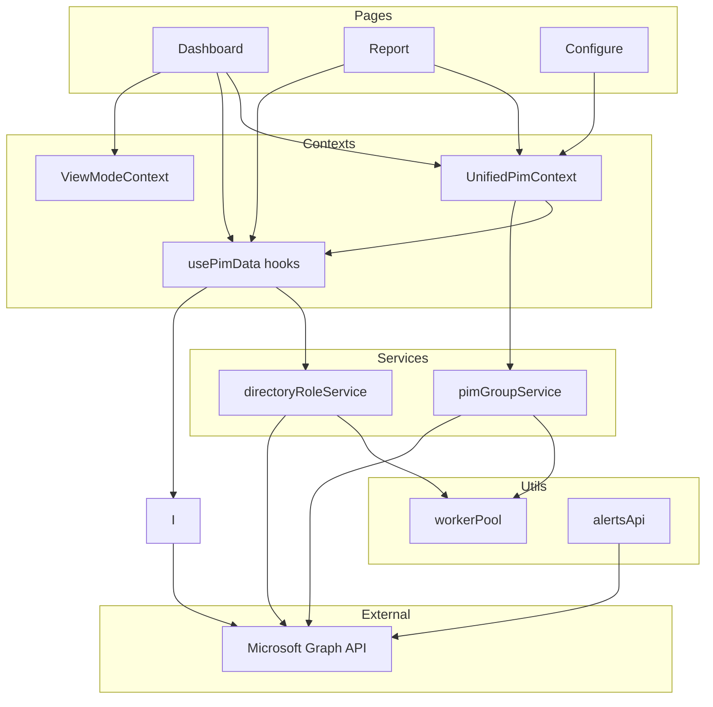

# Folder Structure

This document explains the organization of the PIM Manager codebase. Understanding this structure helps you navigate the code and find specific functionality.

---

## Root Directory

```
PIM-manager/
├── docs/                  # Documentation (you are here)
├── public/                # Static assets (icons, images)
├── src/                   # Source code (main application)
├── package.json           # Dependencies and scripts
├── azuredeploy.json       # ARM template for self-hosting on Azure
└── README.md              # Project overview
```

---

## Source Code (`/src`)

The `/src` folder contains all application code, organized by purpose:

```
src/
├── app/                   # Pages (Next.js App Router)
├── components/            # Reusable UI components
├── contexts/              # React Context providers
├── services/              # Data fetching logic
├── types/                 # TypeScript type definitions
├── utils/                 # Helper functions
├── config/                # Configuration constants and user texts
├── hooks/                 # Custom React hooks
├── workloads/             # Workload adapters and the loading engine
└── demo/                  # Live demo on a made-up tenant (Contoso)
```

---

## Detailed Breakdown

### `src/app/` - Pages

Each subfolder represents a page in the application.

| Folder | Purpose |
|--------|---------|
| `app/page.tsx` | Landing page (login) |
| `app/dashboard/` | Dashboard overview |
| `app/report/` | Main report page with all role data |
| `app/configure/` | PIM configuration page (Edit, Guided, Import, Access model) |
| `app/audit/` | Audit: activations and changes in Entra roles and groups, with the No activation view and export |
| `app/azure/` | The Azure pages: the dashboard, `report/`, `audit/` and `configure/` (a placeholder for now); the layout asks for the Azure consent first |
| `app/settings/` | Settings: workload permissions, display, emergency access accounts, access model labels, Log Analytics workspace, advanced |
| `app/help/` | The full guide, one panel per page |
| `app/demo/` | Starts the live demo on a made-up tenant (hosted version only) |
| `app/redirect/` | Sign-in bridge for MSAL popups and silent sign-in, without navigation |
| `app/layout.tsx` | Shared layout (navigation, providers) |
| `app/globals.css` | Global styles |

> [!NOTE]
> Next.js uses **file-based routing**. The folder structure directly maps to URLs:
> - `/app/report/page.tsx` → `https://yourapp.com/report`

---

### `src/components/` - UI Components

Reusable building blocks used across pages.

| Component | Purpose |
|-----------|---------|
| `ui/` | Shared primitives: Button, Chip, Dialog, Menu, SegmentedControl, StatCard, Tag, Toast, Skeleton, the DurationSlider of Configure and the filter panel of Report, Azure and Audit |
| `shell/` | The frame around every page: top bar, compact header and bottom navigation on a phone, account menu, Help panel and the Entra ID / Azure switch |
| `charts/` | The dashboard's own SVG charts: Donut, StackedBar, BarList |
| `icons/` | The app's own icon set (`Icon.tsx`) |
| `pdf/` | The PDF exports: the report, the audit report and the No activation export |
| `AppProviders.tsx` | The provider tree, rendered by `app/layout.tsx` |
| `AuthProvider.tsx`, `ProtectedRoute.tsx` | MSAL sign-in, and the guard that keeps signed-out visitors off the pages |
| `ExportDialog.tsx` | The export menu (PDF and CSV) |
| `WorkloadChips.tsx` | Chips that turn a workload on or off, with incremental consent |
| `LoadingStatus.tsx`, `SyncStatus.tsx`, `GlobalProgressBar.tsx` | Background loading: the status sentence next to Refresh, "synced ... ago", and one progress line across the workloads |
| `DataWarningBanner.tsx` | Warning with a retry when the policies of some roles could not be read |
| `OnboardingTour.tsx`, `OnboardingWrapper.tsx`, `TourChoiceDialog.tsx`, `DemoTourDialog.tsx` | The tours: the dialog itself, when a tour starts, the choice of tour, and the question in the demo |
| `ErrorBoundary.tsx`, `ThemeProvider.tsx` | Fallback screen on a render error, and dark or light theme |

Components that belong to one page live next to that page, in `app/<page>/components/` (for example the Configure modes in `app/configure/components/`).

---

### `src/services/` - Data Fetching

Core logic for interacting with Microsoft Graph API.

| File | Purpose |
|------|---------|
| `directoryRoleService.ts` | **Directory Roles**: Fetch role definitions, assignments, policies |
| `pimGroupService.ts` | **PIM for Groups**: Fetch PIM-onboarded groups and policies |

**directoryRoleService.ts** contains:
- `getRoleDefinitions()` - Fetch all Entra ID role definitions
- `fetchSinglePolicy()` - Fetch policy for one role
- `concurrentFetchPolicies()` - Parallel policy fetching with worker pool
- `getAllRolesOptimizedWithDeferredPolicies()` - Main data loading with deferred policies

**pimGroupService.ts** contains:
- `fetchAllPimGroupData()` - Full load: inventory, details, assignments and policies per group
- `refreshPimGroupAssignments()` - Smart refresh: inventory plus eligibility and assignment instances and policies per onboarded group, group details kept
- `fetchSingleGroupPolicy()` - Fetch policy for one group


> [!WARNING]
> **Throttling Protection**: Services use worker pools and delays to avoid Graph API throttling (429 errors). Do not remove these safeguards.

---

### `src/types/` - Type Definitions

TypeScript interfaces describing data structures.

| File | Purpose |
|------|---------|
| `directoryRole.types.ts` | Directory Roles types (RoleDefinition, PimPolicy, etc.) |
| `pimGroup.types.ts` | PIM for Groups types (PimGroup, GroupPolicy, etc.) |
| `workload.ts` | Workload system types (WorkloadType, WorkloadData) |
| `roleFilters.ts` | Filter types for role/group filtering |
| `securityAlerts.ts` | Security alerts types |
| `index.ts` | Central exports for easy importing |

**Key types (directoryRole.types.ts):**
- `RoleDefinition` - A Microsoft Entra ID role
- `RoleAssignment` - A permanent assignment
- `PimEligibilitySchedule` - An eligible assignment
- `PimPolicy` - PIM configuration for a role
- `RoleDetailData` - Combined data for one role

**Key types (pimGroup.types.ts):**
- `PimGroup` - A PIM-onboarded group
- `GroupPolicy` - PIM policy for a group (Member or Owner)
- `GroupEligibilitySchedule` - Eligible group membership

---

### `src/utils/` - Helper Functions

Utility functions and API helpers.

| File | Purpose |
|------|---------|
| `policyParser.ts` | **Policy Parsing**: `parseGraphPolicy`, Graph API policy rules into typed settings (pure, moved from `services/`) |
| `workerPool.ts` | **Worker Pool**: Parallel API calls with concurrency control and throttling protection (default: 8 workers, 300ms) |
| `retryUtils.ts` | **Retry Logic**: `withRetry()` with exponential backoff for 429/5xx errors |
| `durationUtils.ts` | **Duration Helpers**: ISO 8601 parsing, formatting, and Graph API duration conversions |
| `etagCache.ts` | **ETag Cache**: ETag-based HTTP caching to avoid redundant API calls |
| `scopeUtils.ts` | **Scope Detection**: Identify scope types (Tenant-wide, App-scoped, AU, RMAU, etc.) |
| `logger.ts` | **Centralized Logging**: Structured logging with dynamic level via localStorage |
| `authContextApi.ts` | **Authentication Contexts**: Fetch Conditional Access authentication contexts |
| `alertFormatting.ts` | **Alert Formatting**: Format and sort security alerts by severity |
| `exportReport.ts` | **Export**: the content of the PDF and CSV export as plain data (tested); `ReportDocument.tsx` draws it |

---

### `src/config/` - Configuration

Application configuration constants.

| File | Purpose |
|------|---------|
| `authConfig.ts` | Microsoft Entra ID authentication configuration |
| `constants.ts` | Application-wide constants |
| `exportReport.ts` (`EXPORT_BLOCKS`) | **Export blocks** - single source of truth for the content blocks of the export |

> [!TIP]
> To add a block to the export, add it to `EXPORT_BLOCKS` and `buildExportReport` in `utils/exportReport.ts`. It appears in the export dialog and the PDF.

> [!CAUTION]
> The `authConfig.ts` file contains your **Microsoft Entra ID client ID**. Ensure this matches your app registration.

---

### `src/hooks/` - Custom Hooks

Reusable React hooks.

| File | Purpose |
|------|---------|
| `usePimData.ts` | **Directory Roles Data**: Access roles data, policies, refresh functions |
| `usePimSelectors.ts` | **Memoized Selectors**: Optimized selectors to avoid unnecessary re-renders |
| `useAggregatedData.ts` | **Data Aggregation**: Combines data across multiple workloads (Directory Roles, PIM for Groups) |
| `useRoleFilters.ts` | **Filter Management**: Role/group filtering logic for Report and Dashboard pages |
| `useConsentedWorkloads.ts` | **Workload Permissions**: Manages which workloads have user consent |
| `useIncrementalConsent.ts` | **Consent Flow**: Handles incremental permission requests |
| `useNavigationGuard.ts` | **Navigation Guard**: Warns on unsaved changes when navigating away |

### `src/contexts/` - React Context Providers

Global state management with React Context API.

| File | Purpose |
|------|---------|
| `UnifiedPimContext.tsx` | **Main Orchestrator**: Manages all workloads (Directory Roles, PIM for Groups) with unified refresh logic |
| `AzureContext.tsx` | **Azure State**: The Azure assignments and scopes, mounted only on the Azure pages |
| `ConfigureBasketContext.tsx` | **Configure Basket**: The changes collected in Configure, kept per tenant in sessionStorage until applied or discarded |
| `DemoModeContext.tsx` | **Demo**: Tells components they run in the live demo, so actions that write to a tenant are disabled |
| `ViewModeContext.tsx` | **UI Preferences**: Manages Basic/Advanced view mode toggle with localStorage persistence |
| `ToastContext.tsx` | **Notifications**: Toast notification system (success/error/info, auto-dismiss 3s) |

**Key Context Relationships:**
- `UnifiedPimContext` orchestrates multiple workloads
- The hooks in `hooks/usePimData.ts` (`useRolesData`, `useRolesLoading`, `useRolesActions`) give the Directory Roles part of it
- Dashboard and Report pages read the data through those hooks

---

## File Relationships



---

## Next Steps

- [Data Flow](./03-data-flow.md) - See how data moves through these files
- [Graph API Calls](./04-graph-api-calls.md) - Learn which APIs are called
