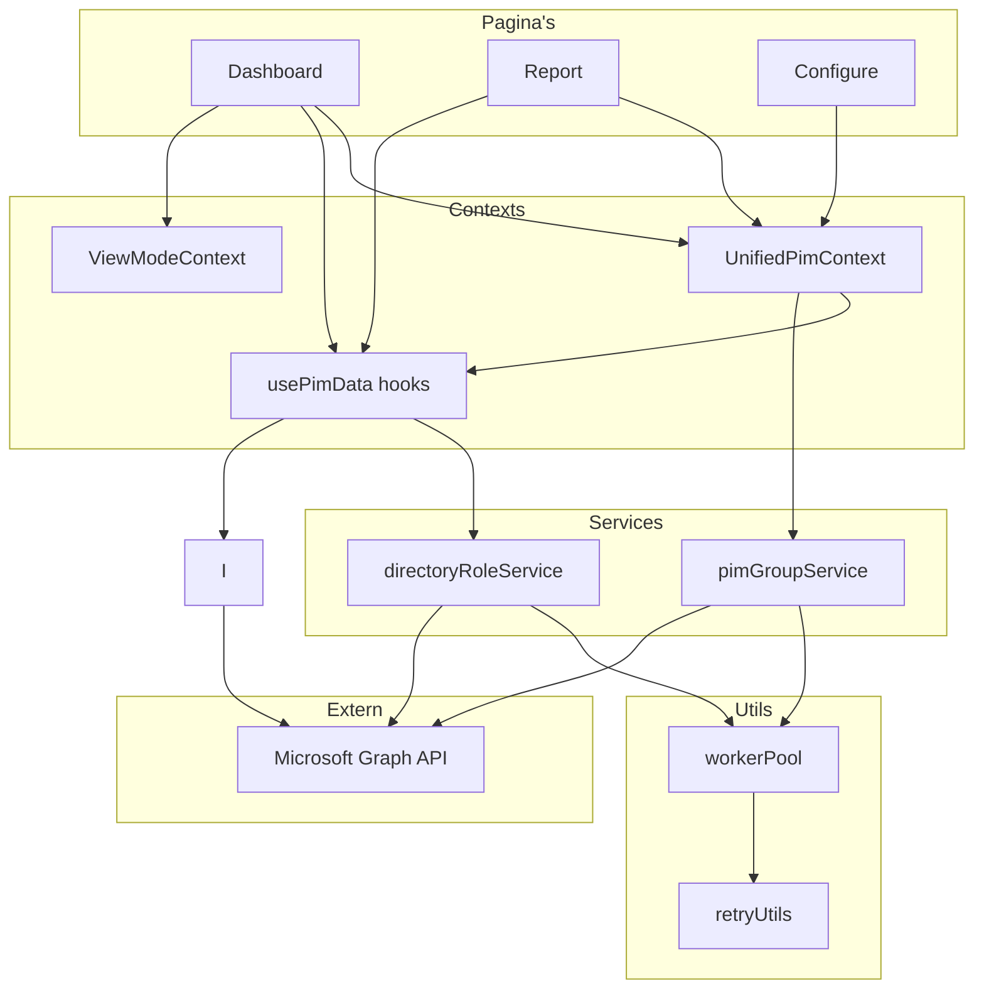

# Mappenstructuur

Dit document legt de organisatie van de PIM Manager codebase uit. Het begrijpen van deze structuur helpt je navigeren door de code en specifieke functionaliteit te vinden.

---

## Hoofdmap

```
PIM-manager/
├── docs/                  # Documentatie (je bent hier)
├── public/                # Statische bestanden (iconen, afbeeldingen)
├── src/                   # Broncode (hoofdapplicatie)
├── package.json           # Dependencies en scripts
├── azuredeploy.json       # ARM-template voor zelf hosten op Azure
└── README.md              # Project overzicht
```

---

## Broncode (`/src`)

De `/src` map bevat alle applicatiecode, georganiseerd op doel:

```
src/
├── app/                   # Pagina's (Next.js App Router)
├── components/            # Herbruikbare UI-componenten
├── contexts/              # React Context providers
├── services/              # Data-ophaal logica
├── types/                 # TypeScript type definities
├── utils/                 # Hulpfuncties
├── config/                # Configuratie constanten en gebruikersteksten
├── hooks/                 # Custom React hooks
├── workloads/             # Workload-adapters en de laadengine
└── demo/                  # Live demo op een verzonnen tenant (Contoso)
```

---

## Gedetailleerd Overzicht

### `src/app/` - Pagina's

Elke submap vertegenwoordigt een pagina in de applicatie.

| Map | Doel |
|-----|------|
| `app/page.tsx` | Landingspagina (login) |
| `app/dashboard/` | Dashboard overzicht |
| `app/report/` | Hoofdrapportpagina met alle roldata |
| `app/configure/` | PIM configuratiepagina (Edit, Guided, Import, Access model) |
| `app/audit/` | Audit: activaties en wijzigingen in Entra-rollen en -groepen, met de weergave No activation en export |
| `app/azure/` | De Azure-pagina's: het dashboard, `report/`, `audit/` en `configure/` (voorlopig een placeholder); de layout vraagt eerst de Azure-consent |
| `app/settings/` | Instellingen: workloadmachtigingen, weergave, noodaccounts, labels van het access model, Log Analytics-workspace, geavanceerd |
| `app/help/` | De volledige gids, één paneel per pagina |
| `app/demo/` | Start de live demo op een verzonnen tenant (alleen op de gehoste versie) |
| `app/redirect/` | Aanmeldbrug voor MSAL-popups en stil aanmelden, zonder navigatie |
| `app/layout.tsx` | Gedeelde layout (navigatie, providers) |
| `app/globals.css` | Globale stijlen |

> [!NOTE]
> Next.js gebruikt **bestandsgebaseerde routing**. De mappenstructuur komt direct overeen met URLs:
> - `/app/report/page.tsx` → `https://jouwapp.com/report`

---

### `src/components/` - UI Componenten

Herbruikbare bouwstenen die op meerdere pagina's worden gebruikt.

| Component | Doel |
|-----------|------|
| `ui/` | Gedeelde bouwstenen: Button, Chip, Dialog, Menu, SegmentedControl, StatCard, Tag, Toast, Skeleton, de DurationSlider van Configureren en het filterpaneel van Rapport, Azure en Audit |
| `shell/` | Het kader om elke pagina: bovenbalk, compacte header en navigatie onderin op een telefoon, accountmenu, Help-paneel en de wissel tussen Entra ID en Azure |
| `charts/` | De eigen SVG-grafieken van het dashboard: Donut, StackedBar, BarList |
| `icons/` | De eigen iconenset van de app (`Icon.tsx`) |
| `pdf/` | De PDF-exports: het rapport, het auditrapport en de export No activation |
| `AppProviders.tsx` | De providerboom, gerenderd door `app/layout.tsx` |
| `AuthProvider.tsx`, `ProtectedRoute.tsx` | Aanmelden met MSAL, en de bewaking die niet-aangemelde bezoekers van de pagina's weghoudt |
| `ExportDialog.tsx` | Het exportmenu (PDF en CSV) |
| `WorkloadChips.tsx` | Chips die een workload aan- of uitzetten, met incremental consent |
| `LoadingStatus.tsx`, `SyncStatus.tsx`, `GlobalProgressBar.tsx` | Laden op de achtergrond: de statuszin naast Refresh, "synced ... ago" en één voortgangslijn over de workloads |
| `DataWarningBanner.tsx` | Waarschuwing met een nieuwe poging als de policies van een paar rollen niet te lezen waren |
| `OnboardingTour.tsx`, `OnboardingWrapper.tsx`, `TourChoiceDialog.tsx`, `DemoTourDialog.tsx` | De tours: de dialoog zelf, wanneer een tour start, de keuze van de tour en de vraag in de demo |
| `ErrorBoundary.tsx`, `ThemeProvider.tsx` | Terugvalscherm bij een renderfout, en het donkere of lichte thema |

Componenten die bij één pagina horen staan naast die pagina, in `app/<pagina>/components/` (bijvoorbeeld de modi van Configureren in `app/configure/components/`).

---

### `src/services/` - Data Ophalen

Kernlogica voor interactie met Microsoft Graph API.

| Bestand | Doel |
|---------|------|
| `directoryRoleService.ts` | **Directory Roles**: Ophalen van roldefinities, toewijzingen, policies |
| `pimGroupService.ts` | **PIM for Groups**: Ophalen van PIM-onboarded groepen en policies |

**directoryRoleService.ts** bevat:
- `getRoleDefinitions()` - Ophalen van roldefinities
- `fetchSinglePolicy()` - Ophalen van één rol's PIM-beleid
- `concurrentFetchPolicies()` - Achtergrond policy-ophalen
- `getAllRolesOptimizedWithDeferredPolicies()` - Hoofdfunctie voor data-laden

**pimGroupService.ts** bevat:
- `fetchAllPimGroupData()` - Volledig laden: inventaris, details, toewijzingen en policies per groep
- `refreshPimGroupAssignments()` - Slim verversen: inventaris plus eligibility- en assignment-instances en policies per onboarded groep, groepsdetails blijven behouden
- `fetchSingleGroupPolicy()` - Ophalen van beleid voor één groep


> [!WARNING]
> **Throttling Bescherming**: Services gebruiken worker pools en vertragingen om Graph API throttling (429 fouten) te voorkomen. Verwijder deze beveiligingen niet.

---

### `src/types/` - Type Definities

TypeScript interfaces die datastructuren beschrijven.

| Bestand | Doel |
|---------|------|
| `directoryRole.types.ts` | Directory Roles types (RoleDefinition, PimPolicy, etc.) |
| `pimGroup.types.ts` | PIM for Groups types (PimGroup, GroupPolicy, etc.) |
| `workload.ts` | Workload systeem types (WorkloadType, WorkloadData) |
| `roleFilters.ts` | Filter types voor rol/groep filteren |
| `securityAlerts.ts` | Security alert types |
| `index.ts` | Centrale exports voor makkelijk importeren |

**Belangrijke types (directoryRole.types.ts):**
- `RoleDefinition` - Een Microsoft Entra ID rol
- `RoleAssignment` - Een permanente toewijzing
- `PimEligibilitySchedule` - Een eligible toewijzing
- `PimPolicy` - PIM-configuratie voor een rol
- `RoleDetailData` - Gecombineerde data voor één rol

---

### `src/utils/` - Hulpfuncties

Utility functies en API helpers.

| Bestand | Doel |
|---------|------|
| `policyParser.ts` | **Policy Parsing**: `parseGraphPolicy`, Graph API policy regels naar getypede instellingen (puur, verplaatst uit `services/`) |
| `workerPool.ts` | **Worker Pool**: Parallelle API-calls met gelijktijdigheidscontrole en throttling bescherming (standaard: 8 workers, 300ms) |
| `retryUtils.ts` | **Retry Logica**: `withRetry()` met exponentiële backoff voor 429/5xx fouten |
| `durationUtils.ts` | **Duration Helpers**: ISO 8601 parsing, formattering en Graph API duration conversies |
| `etagCache.ts` | **ETag Cache**: ETag-gebaseerde HTTP caching om overbodige API-calls te vermijden |
| `scopeUtils.ts` | **Scope Detectie**: Identificeer scope types (Tenant-breed, App-scoped, AU, RMAU, etc.) |
| `logger.ts` | **Gecentraliseerde Logging**: Gestructureerde logging met dynamisch niveau via localStorage |
| `authContextApi.ts` | **Authenticatie Contexten**: Haal Conditional Access authenticatie contexten op |
| `alertFormatting.ts` | **Alert Formattering**: Formatteer en sorteer security alerts op ernst |
| `exportReport.ts` | **Export**: de inhoud van de PDF en CSV export als gewone data (getest); `ReportDocument.tsx` tekent hem |

---

### `src/config/` - Configuratie

Applicatie configuratie constanten.

| Bestand | Doel |
|---------|------|
| `authConfig.ts` | Microsoft Entra ID authenticatie configuratie |
| `constants.ts` | Applicatie-brede constanten |
| `exportReport.ts` (`EXPORT_BLOCKS`) | **Export blokken** - single source of truth voor de inhoudsblokken van de export |

> [!TIP]
> Een blok toevoegen aan de export: voeg het toe aan `EXPORT_BLOCKS` en `buildExportReport` in `utils/exportReport.ts`. Het verschijnt in het exportmenu en de PDF.

> [!CAUTION]
> Het `authConfig.ts` bestand bevat je **Microsoft Entra ID client ID**. Zorg ervoor dat dit overeenkomt met je app-registratie.

---

### `src/hooks/` - Custom Hooks

Herbruikbare React hooks.

| Bestand | Doel |
|---------|------|
| `usePimData.ts` | **Directory Roles Data**: Toegang tot roldata, policies, ververs-functies |
| `usePimSelectors.ts` | **Gememoïseerde Selectors**: Geoptimaliseerde selectors om onnodige re-renders te voorkomen |
| `useAggregatedData.ts` | **Data Aggregatie**: Combineert data over meerdere workloads (Directory Roles, PIM for Groups) |
| `useRoleFilters.ts` | **Filter Beheer**: Rol/groep filter logica voor Report en Dashboard pagina's |
| `useConsentedWorkloads.ts` | **Workload Machtigingen**: Beheert welke workloads gebruikersconsent hebben |
| `useIncrementalConsent.ts` | **Consent Flow**: Verwerkt incrementele toestemmingsverzoeken |
| `useNavigationGuard.ts` | **Navigatie Guard**: Waarschuwt bij onopgeslagen wijzigingen bij wegnavigeren |

### `src/contexts/` - React Context Providers

Globale state management met React Context API.

| Bestand | Doel |
|---------|------|
| `UnifiedPimContext.tsx` | **Hoofd Orchestrator**: Beheert alle workloads (Directory Roles, PIM for Groups) met unified refresh logica |
| `AzureContext.tsx` | **Azure State**: De Azure-toewijzingen en scopes, alleen geladen op de Azure-pagina's |
| `ConfigureBasketContext.tsx` | **Configure Mandje**: De wijzigingen die je in Configureren verzamelt, per tenant in sessionStorage tot je ze toepast of weggooit |
| `DemoModeContext.tsx` | **Demo**: Vertelt componenten dat ze in de live demo draaien, zodat acties die naar een tenant schrijven uit staan |
| `ViewModeContext.tsx` | **UI Voorkeuren**: Beheert Basic/Advanced view mode toggle met localStorage persistentie |
| `ToastContext.tsx` | **Notificaties**: Toast notificatiesysteem (succes/fout/info, automatisch sluiten na 3s) |

**Belangrijke Context Relaties:**
- `UnifiedPimContext` orkestreert meerdere workloads
- De hooks in `hooks/usePimData.ts` (`useRolesData`, `useRolesLoading`, `useRolesActions`) geven het Directory Roles-deel ervan
- Dashboard en Report pagina's lezen de data via die hooks

---

## Bestandsrelaties



---

## Volgende Stappen

- [Dataflow](./03-dataflow.md) - Zie hoe data door deze bestanden stroomt
- [Graph API Calls](./04-graph-api-calls.md) - Leer welke APIs worden aangeroepen
